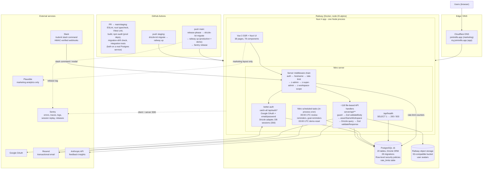

# Trellis System Architecture

**TL;DR:** Trellis is a single Nuxt 4 application (SSR frontend + Nitro API in one Node process), backed by Railway-hosted PostgreSQL, using Drizzle ORM with a committed migration chain, better-auth for authentication, Nitro scheduled tasks for background work, Zod-validated file-based API routes, a two-tier Vitest suite, Sentry for observability, and GitHub Actions deploying Docker images to Railway across staging, demo and production environments. It runs in production at `my.jointrellis.app`.

---

## Architecture diagram



---

## 1. Relational database, ORM and migrations

**PostgreSQL 16 via Drizzle ORM** (`drizzle-orm` + `postgres` driver, `drizzle-kit` for migrations).

- **Schema as code:** `server/database/schema.ts` is the single source of truth. 20 tables: `workspaces`, `users`, `feedback`, `goals`, `goal_milestones`, `goal_notes`, `review_schedules`, `review_templates`, `buddy_checkins`, `feedback_insights`, `achievements`, `notifications`, `onboarding_imports`, `feedback_prompts`, `slack_workspaces`, `demo_requests`, `rate_limits`, plus the better-auth tables `session`, `account`, `verification`.
- **Migrations:** 28 SQL migrations in `server/database/migrations/` generated by `drizzle-kit generate`, applied with `drizzle-kit migrate`. Hand-written SQL migrations exist where the generator can't express the change (workspace backfill, `DEFAULT current_setting(...)`, RLS role and policies).
- **Migrations run in CI before every deploy** (staging, demo and production workflows each run `npm run db:migrate` against that environment's `DATABASE_URL`, then deploy).
- **Drift guard in CI:** a dedicated job builds one database from the migration chain and one from `schema.ts` via `drizzle-kit push`, then diffs `information_schema.columns`. A column that exists in the schema but was never emitted as migration DDL fails the PR.
- **Multi-tenancy at the DB layer:** every content table carries `workspace_id`. Row-level security policies (`tenant_isolation`) plus a restricted `trellis_app` role are created by migration 0025. The app binds the caller's workspace onto a reserved connection per request via `set_config('app.current_workspace_id', ...)`, and an `AsyncLocalStorage` proxy around `db` routes every query through that connection (`server/database/connection.ts`, `server/middleware/z-workspace-scope.ts`). Background tasks and super-admin routes run under an explicit `withRlsBypass` transaction. Application-level `assertSameWorkspace` checks remain as the first line of defence.
- **Connection pooling:** `postgres` pool, max 20 in production, SSL required, 30-minute connection lifetime.
- **Seeding and ops scripts:** `db:seed`, `db:seed-demo`, `db:reset`, and one-off backfill scripts under `server/database/scripts/`.

## 2. Auth, background jobs, queues and scheduled work

**Authentication: better-auth** with the Drizzle adapter.

- Two sign-in methods: Google OAuth and email/password (argon2 hashing). Public sign-up is disabled. Accounts are created only through admin CSV import or manual creation, then activated through a token-verified invitation / set-password flow.
- Sessions are server-side rows in Postgres, 30-day expiry, cookie-based.
- A better-auth hook links pre-created (invited) user rows to the OAuth identity on first login inside one transaction, and deletes uninvited OAuth users immediately.
- Roles live on the `users` row: `role` (`user` | `admin`) for workspace admins, `is_super_admin` for the platform operator. Privilege fields are `input: false` so they cannot be changed through better-auth's update-user endpoint.
- **Server middleware chain** (`server/middleware/`, alphabetical execution order):
  1. `auth.ts` – resolves the session, 401s unauthenticated API calls, redirects unauthenticated page loads to `/login?returnTo=`, attaches user and workspace to the event context.
  2. `hostname.ts` – apex vs app subdomain routing in production.
  3. `rate-limit.ts` – Postgres-backed counters (survive restarts, shared across replicas), trusted-proxy-aware client IP, per-account exponential backoff on failed sign-ins.
  4. `z-admin.ts` / `z-super-admin.ts` – gate `/api/admin/*` and `/api/super-admin/*`.
  5. `z-workspace-scope.ts` – reserves a DB connection and binds the tenant context for RLS.
- Handlers additionally call `requireUser` / `requireAdmin` / `requireSuperAdmin` (`server/utils/auth-guards.ts`) for typed defence in depth.
- Security headers (CSP, HSTS, frame-ancestors none, nosniff) are set globally via Nitro route rules. Slack webhooks are HMAC signature-verified. Slack bot tokens are stored encrypted.

**Background and scheduled work: Nitro scheduled tasks** (`nitro.experimental.tasks` + `scheduledTasks` in `nuxt.config.ts`).

| Task | Schedule | What it does |
|------|----------|--------------|
| `review-reminders` | 09:00 UTC daily | 7-day and 1-day email + in-app reminders for scheduled reviews, flags each row so reminders are idempotent. Also triggerable per-workspace by an admin via `POST /api/admin/trigger-review-reminders`. |
| `goal-reminders` | 09:00 UTC daily | Emits `goal_approaching` and `goal_overdue` in-app notifications. |
| `demo-reset` | 03:00 UTC daily | Wipes and reseeds the demo environment. No-op unless `DEMO_MODE=true`. |

- Tasks run in-process inside the Nitro server (cron evaluated by Nitro itself), each wrapped in `withRlsBypass` because they span workspaces. Slow external I/O (email sends with rate-limit sleeps) is deliberately kept outside the bypass transaction.
- **Fire-and-forget async work** (buddy notifications after feedback, invitation emails) runs as un-awaited promises inside the request handler with their own error handling. In-app notifications are rows in the `notifications` table.
- **There is no external queue** (no Redis / BullMQ / SQS). This is a deliberate trade-off for the current scale: one process, one database, and durable state (reminder-sent flags, rate-limit counters, notifications) lives in Postgres so a restart cannot lose it. Adding a queue is the obvious next step if email volume or AI-insight generation needs to move off the request path.

## 3. API design

**~118 route handlers under `server/api/`**, using Nitro's file-based routing with HTTP method suffixes (`index.get.ts`, `[id].patch.ts`), grouped by domain:

`achievements`, `admin` (users, onboarding/CSV import, review templates, insights, engagement stats), `analytics`, `auth`, `avatars`, `buddies`, `checkins`, `community`, `dashboard`, `demo`, `feedback`, `feedback-prompts`, `goals` (with nested milestones and notes), `insights`, `integrations/slack`, `marketing`, `notifications`, `reviews`, `super-admin/workspaces`, `user` (data export, account deletion, preferences), `users`, `workspace`.

**Every handler follows the same shape:**

```ts
export default defineEventHandler(async (event) => {
  const user = requireUser(event);                                   // 1. auth guard (typed user)
  const body = await validateBody(event, apiSchemas.CreateX);        // 2. Zod request validation → 400 with issue list
  await assertSameWorkspace(event, body.targetId);                   // 3. tenant check on caller-supplied ids
  const [row] = await db.insert(table).values(...).returning();      // 4. Drizzle query (RLS-scoped connection)
  notifySomeone(row.id);                                             // 5. fire-and-forget side effects
  return validateResponse({ ... }, apiSchemas.CreateXResponse);      // 6. Zod response validation
});
```

- **Schema layering** in `server/schemas/`: `base.ts` (one Zod schema per table), `computed.ts` (joined shapes such as `FeedbackWithReviewer`), `api.ts` (request/response contracts per endpoint), `reviewTemplates.ts` (dynamic review-form field definitions). Types are inferred from these schemas and shared with the client.
- **Consistent error contract:** `createError` with explicit status codes; 400 validation errors carry a `data` array of `{ path, message }`.
- **Cross-cutting concerns live in `server/utils/`:** auth guards, workspace assertions, email templates, in-app notifications, invitations, account deletion/anonymisation, encryption, S3 uploads, Slack signature verification, rate-limit store.
- **better-auth** owns `/api/auth/*` through one catch-all handler; a handful of app-specific auth routes (linked accounts, add/set password, friendly error page) sit beside it.
- **Integrations:** Slack (`/submit` slash command → modal → draft feedback, OAuth install per workspace), Anthropic (feedback theme/sentiment analysis and suggested goals), Resend (email), Railway S3 bucket (avatars).

## 4. Testing, error handling and observability

**Testing: two Vitest tiers plus CI gates** (~150 test files).

| Tier | Config | What it covers |
|------|--------|----------------|
| Unit (fast, mocked) | `vitest.config.ts`, happy-dom | Handlers, middleware, utils, schemas, seed logic with the DB mocked. Coverage thresholds: 80% statements/branches/lines on `server/api` and `server/utils`. |
| Integration (real Postgres) | `vitest.integration.config.ts` | The real query layer against a disposable Postgres built from `schema.ts`: workspace scoping, RLS policies under the restricted role, rate-limit store, reminder tasks, middleware. Runs serially with per-test truncation. |

PR CI (`.github/workflows/test.yml`) runs on every PR to `staging` or `main`: ESLint → `nuxt typecheck` → unit tests → production build, plus three parallel jobs: `npm audit` on production deps (fails on high/critical), the migration-drift check, and the integration tier, the last two on a Postgres 16 service container.

**Error handling:**

- Server: uniform `createError` responses; Zod validation failures return structured 400s; auth guards return 401/403; handlers catch DB errors and return generic 500 messages while logging the real error server-side.
- Client: a branded `app/error.vue` with status-specific copy; stale-chunk errors after a redeploy are auto-reloaded by Nuxt and filtered out of Sentry.
- Health: `GET /api/health` runs `SELECT 1` and returns 503 on DB failure. Railway uses it as the deploy health check (300s timeout), so a deploy that cannot reach the database never receives traffic.
- Rate limiting and sign-in lockout protect the auth surface; Slack requests failing signature verification are rejected.

**Observability:**

- **Sentry** (`@sentry/nuxt`) on both client and server: errors, performance traces (10% sample), structured logs (`enableLogs`), session replay (10% of sessions, 100% on error), PII off. Every event is tagged with `release = package.json version` and `environment`, and the production workflow creates a Sentry release with commit association, so regressions map to a version.
- **Railway logs** capture structured `console` output from tasks, email sends and failures.
- **Plausible** for marketing-site analytics only (never loaded on the authenticated app).
- A super-admin-only `/api/_debug/scope` endpoint reports the live RLS context of a request, used during the staging soak of the tenancy work.

## 5. Deployment and hosting

**Hosted on Railway**, deployed as a Docker image from GitHub Actions. In production for real users under `jointrellis.app` (marketing) and `my.jointrellis.app` (app), with Cloudflare handling DNS.

| Environment | Branch | Deploy trigger | Database |
|-------------|--------|----------------|----------|
| Local | any | `npm run dev` | local Postgres |
| Staging | `staging` | push → migrate → `railway up` | Railway Postgres (staging) |
| Demo | `main` release | same pipeline as production, `DEMO_MODE=true`, nightly reseed | Railway Postgres (demo) |
| Production | `main` | release-please creates a release → migrate → `railway up` → Sentry release | Railway Postgres (production) |

- **Build:** multi-stage `Dockerfile` (`node:20-alpine`): `npm ci` + `nuxt build` in the builder, only `.output/` copied into the runner, runs as the non-root `node` user, `node .output/server/index.mjs` on port 3000.
- **Release flow:** feature branch → PR to `staging` (CI gates) → auto-deploy to staging → PR `staging` → `main` → release-please bumps `package.json`, updates `CHANGELOG.md` and tags (currently `v0.19.0`) → production and demo deploy in parallel → Sentry release is created and finalised.
- **Migrations before deploy:** each deploy job runs `drizzle-kit migrate` against that environment's database before the new image goes live.
- **One Railway service, three environments:** environment-scoped Railway tokens route each workflow to the right environment.
- **Storage:** Railway's S3-compatible object storage holds user avatars, served through `/api/avatars/*`.
- **Configuration:** all secrets via environment variables (`DATABASE_URL`, `BETTER_AUTH_SECRET`, Google OAuth, Resend, Anthropic, Slack, Sentry DSN, S3 credentials), distinct per environment.
- **Rollback:** redeploy a previous Railway deployment, or revert on `main`.

---

## Honest gaps and next steps

- **No external job queue.** Scheduled and async work is in-process. Fine at current scale, but a queue is the next step if email or AI-insight volume grows.
- **RLS enforcement depends on the connection-role cutover.** Policies and the restricted role ship via migration; enforcement begins when each environment's `DATABASE_URL` is pointed at `trellis_app` (documented in `docs/audits/rls-cutover-handoff.md`). Application-level workspace checks are active regardless.
- **Single process, vertical scaling.** Rate-limit counters and sessions are already in Postgres, so horizontal replicas are possible, but the cron tasks would need a leader lock before running more than one instance.
- **Frontend tests are thin** (2 component test files); the test investment is deliberately in the server and query layer.
